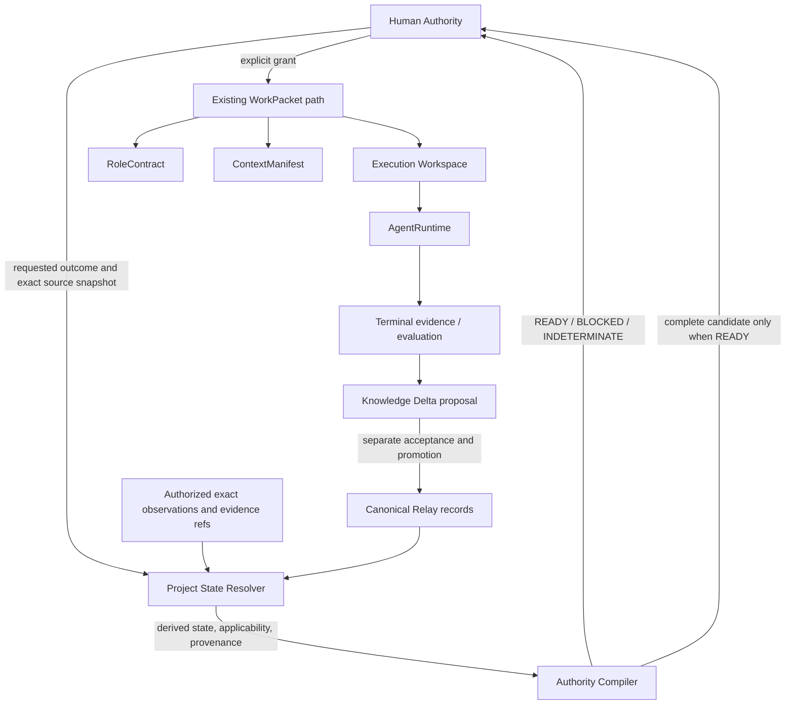

# Slice 2.5 — Project State Resolution and Authority Compilation

- **Document class:** Normative design candidate
- **Status:** DESIGN CANDIDATE — UNACCEPTED / IMPLEMENTATION NOT AUTHORIZED
- **Date:** 2026-10-24
- **Slice:** 2.5 — Project State Resolution and Authority Compilation
- **Opening authority:** `RLY-S25-OPEN-001 — OPEN`
- **Design authority:** `RLY-S25-DESIGN-AUTH-001 — AUTHORIZED`
- **Review revision:** 2 — corrective design candidate after `RLY-S25-DESIGN-EVAL-001 — REWORK`
- **Strategic authority:** `RLY-P2-STATE-AUTHORITY-COMPILATION-STRATEGIC-AMEND-001 — AUTHORIZED`
- **Exact design-branch base:** `029712fd31f79ee75f4b85e3cdfbc41a85d4770f`
- **Corrective rework base:** `d46ab2ecde9f7a987feeea9937db3f36f72ba48b`
- **Canonical opening baseline:** `fbe41dfcb72df2dd3d145818c6b22478416de789`

## 1. Purpose and disposition

Slice 2.5 defines the deterministic contract by which Relay resolves accepted project knowledge into present-tense prerequisites, inherited constraints, evidence applicability, prohibitions, responsibility ownership, and a complete authority candidate for Human review.

The design addresses a governance gap: settled project obligations can exist in accepted records but still be omitted from later work because a Human, evaluator, or implementer must reconstruct them from memory or prose. Relay must resolve the applicable envelope before the existing WorkPacket path proceeds.

This document is a normative design candidate. It has not been independently accepted or Human-accepted. It authorizes no implementation.

```text
Slice 2.4: COMPLETE / ACCEPTED / CLOSED
Slice 2.5: OPEN
Design: AUTHORIZED / CANDIDATE PRODUCED / NOT ACCEPTED
Implementation: NOT AUTHORIZED
Production ProjectStateResolver: NOT AUTHORIZED
Production AuthorityCompiler: NOT AUTHORIZED
Phase 3: NOT OPEN / NOT AUTHORIZED
```

## 2. Architectural decisions

### D25-01 — Canonical Relay records remain the only durable authority source

**Binds:** Project-state facts and constraints are resolved from exact accepted Relay records and explicitly authorized external observations.
**Prevents:** A graph, cache, chat transcript, working draft, or agent memory becoming a competing source of truth.
**Rule:** Every resolved claim carries exact source identity and provenance. No claim is promoted by inference from descriptive prose.

### D25-02 — Resolution is a deterministic projection for one exact snapshot

**Binds:** A resolution request to one exact repository/source snapshot, registry digest, request identity, and authorized observation set.
**Prevents:** Results changing because a branch moved, a newer artifact appeared, iteration order changed, or wall-clock time passed.
**Rule:** The same normalized request and exact inputs produce the same resolution and candidate content.

### D25-03 — Resolver and compiler prepare; Human Authority authorizes

**Binds:** `READY` means all required predicates are established and a complete authority candidate can be presented.
**Prevents:** Qualification, evidence, resolver output, or compiler output being mistaken for permission to act.
**Rule:** `READY != AUTHORIZED`; only the existing Human Authority path grants authority.

### D25-04 — WorkPacket remains the external governed work unit

**Binds:** The compiled authority candidate to the existing Slice 2.3 WorkPacket construction and identity rules after Human authorization.
**Prevents:** A parallel task format, hidden execution queue, or second authority identity.
**Rule:** Slice 2.5 may gate and supply the existing WorkPacket path; it does not create or execute a WorkPacket.

### D25-05 — Historical evidence is immutable; applicability is derived

**Binds:** A historical result to the exact subject envelope for which it was observed.
**Prevents:** Rewriting a prior PASS as FAIL/STALE or reusing it for a changed subject.
**Rule:** A mismatch changes current applicability, never historical evidence.

### D25-06 — Requirement relations are a bounded domain graph

**Binds:** Prerequisites, prohibitions, consumption, and production to explicit typed relations.
**Prevents:** A generic workflow language, task scheduler, or untyped graph engine.
**Rule:** Only `REQUIRES`, `FORBIDS`, `CONSUMES`, and `PRODUCES` have Slice 2.5 semantics. An unknown relation fails closed.

### D25-07 — Negative decisions and responsibility ownership are enforced inputs

**Binds:** Rejected/prohibited approaches and accepted component responsibilities to exact scope and provenance.
**Prevents:** Silent resurrection of rejected designs or unreviewed duplicate owners.
**Rule:** A matching prohibition or high-confidence responsibility collision blocks ordinary authority compilation.

### D25-08 — Knowledge Delta is a proposal, not a write path

**Binds:** Newly discovered rules and prerequisites to evidence and a proposed disposition.
**Prevents:** Workers, evaluators, runtimes, or the compiler self-promoting new durable knowledge.
**Rule:** Only separate Relay governance and canonical acceptance/promotion can make a Knowledge Delta constrain later resolution.

### D25-09 — Derived state is rebuildable and non-authoritative

**Binds:** Any materialized projection or cache to the exact source snapshot and deterministic reconstruction rules.
**Prevents:** State drift between canonical records and an independently mutable project graph.
**Rule:** No graph database or durable independent project-state store is required or authorized.

### D25-10 — Unknown required facts never produce optimistic readiness

**Binds:** Incomplete source, unknown applicability, conflict, and unsupported rules to `INDETERMINATE`.
**Prevents:** Treating absence of evidence as evidence of satisfaction.
**Rule:** Known blockers yield `BLOCKED`; absent a known blocker, any unresolved required fact yields `INDETERMINATE`; only fully established requirements yield `READY`.

## 3. System boundary and ownership



Slice 2.5 owns the resolution and compilation contract only.

| Existing boundary | Slice 2.5 relationship |
| --- | --- |
| Human Authority | Receives a candidate and grants or denies authority. Resolver/compiler cannot decide for the Human. |
| Slice 1.10 canonical-source and promotion discipline | Supplies exact canonical source identity and acceptance/promotion rules. Slice 2.5 does not replace them. |
| Slice 2.1 AgentRuntime | Supplies accepted runtime facts/evidence by exact reference where relevant. Slice 2.5 never invokes or redefines the runtime. |
| Slice 2.2 RoleContract | Supplies actor/action eligibility and successor/exhaustion semantics. Slice 2.5 does not create roles or role authority. |
| Slice 2.3 WorkPacket / ContextManifest | Remains the authoritative external work unit and context transport. Slice 2.5 gates/supplies its existing path. |
| Slice 2.4 Execution Workspace | Supplies workspace plan, provider, and conformance semantics. Slice 2.5 may require exact qualification facts but does not duplicate enforcement. |
| Phase 3 | Owns authorized packet selection, runtime invocation, and engineering-result orchestration. Slice 2.5 does not absorb these responsibilities. |

The exact accepted predecessor implementations are Slice 2.1 `4f785f08576e465cd0aa278f927fa4b7253e3f49`, Slice 2.2 `4400bd1da0db04e41077c3a6ed1c16d258104ba5`, Slice 2.3 `861ccb6bda528a98e1f570a32dcddc61358732e7`, and Slice 2.4 `73a1525282e41464d31cd458b8a50703bfa9553c`. This design does not reopen or mutate those accepted subjects.

The resolver is not a planner. The compiler is not a planner or authority issuer. The requirement graph is not a generic workflow engine. Runtime-local plans, milestones, and subagents remain non-authoritative execution details.

## 4. Canonical source and exact snapshot model

### 4.1 Resolution snapshot

Every resolution is evaluated against an explicit immutable snapshot containing, conceptually:

- exact project and repository identity;
- exact source `CommitRef`;
- exact repository-registry bytes and digest observed at that commit;
- exact canonical pointers and their target artifact revisions, used to select current projections rather than to confer authority on their claims;
- the accepted source-coverage declaration for the requested outcome;
- exact referenced immutable/locked records and content digests;
- exact backing provenance for any authority-bearing predicate summarized by a living projection;
- exact accepted evidence, qualification, and consumption records required by the request;
- explicitly authorized external observations, each with source identity, observation time/provenance, and exact subject; and
- a normalized requested-outcome identity and applicable design/policy references.

This is an evaluation input, not a new mutable database. The registry and canonical artifact references follow the existing repository contract. Each artifact is verified against its registered digest at the pinned source commit. The snapshot does not resolve `latest`, branch head, a filesystem's incidental contents, or a document found by path alone.

The design candidate's own source lineage is:

| Source | Exact identity | Use in this candidate |
| --- | --- | --- |
| Canonical opening baseline | Commit `fbe41dfcb72df2dd3d145818c6b22478416de789` | Opening state and Slice 2.5 authority frontier. |
| Design-branch base snapshot | Commit `029712fd31f79ee75f4b85e3cdfbc41a85d4770f`; `CURRENT_BASELINE` registry artifact `art_92e4b6c1-3d75-4fa0-b218-7c5e1d93a640`, revision 158, digest `sha256:6a7362059a842663237b0b6c707ea4e74f87b37f0493e1e8acf51017ddbc7baa` | Exact current governance state at design start. |
| Slice 2.5 design authority | `RLY-S25-DESIGN-AUTH-001`; artifact `art_3b5e7a21-6d84-4fc0-a127-9e52c68d3410`, revision 1, digest `sha256:906aaf2469c0ff164732d8cb9abb81aa3ec2ca3ddda066114dc09fd9e0090192` | Governs this design-only candidate and its mandatory coverage. |
| Slice 2.5 opening | `RLY-S25-OPEN-001`; artifact `art_7f2a5c91-6d34-4e80-b127-9c3a65e2d418`, revision 1, digest `sha256:dbfd4d20fa94359bd47feeb8db109f165eb160d22a9216692b96d99e0e4850f1` | Establishes the opened Slice boundary. |
| Opened planning source | `docs/slices/SLICE_2_5_PROJECT_STATE_RESOLUTION_AND_AUTHORITY_COMPILATION.md`; artifact `art_b7d3e691-5c42-4a80-9f16-3e8c24d5a710`, revision 3, digest `sha256:6c46cc6a58f85ec039bb4c36ae587ec2d45245b0dfd903603144674ed72fac77` | Planning input; not an independently authoritative rule source. |
| Strategic architecture | `docs/architecture/PROJECT_STATE_RESOLUTION_AND_AUTHORITY_COMPILATION.md`; artifact `art_6c4a8d21-7e35-4b90-a126-9f2d53c7e840`, revision 3, digest `sha256:0cb503b1887c92189fd69177335055bec84d303beb87331d90d57bb70f2ac498` | Planning input under the strategic authority; not accepted design by itself. |
| Accepted Slice 2.4 implementation | `73a1525282e41464d31cd458b8a50703bfa9553c` | Frozen predecessor boundary; workspace enforcement is not reopened. |

The two planning documents above are registered working/review artifacts. They inform the design but do not override the immutable Slice 2.5 Human Authority or create accepted project-state rules by themselves.

### 4.2 Eligible sources and projection authority

A canonical pointer proves which registered revision is current for that canonical key. It does not, by itself, prove the authority semantics of every claim in that revision. The resolver distinguishes projection selection from predicate provenance:

1. **Current canonical projections** provide the exact current projection selected by the pinned registry. A living summary or planning projection may supply current navigation, selection, and descriptive state, and may point to or summarize an underlying record. It cannot by itself prove Human authority, independent or technical acceptance, qualification acceptance, a prohibition, responsibility ownership, consumption, or another authority-bearing predicate. A higher revision that is not the pointer target is not current for projection selection; pointer currentness still does not make its text an authority record.
2. **Living canonical policy** may state normative rules only within the exact policy ownership, scope, and authority granted by its own accepted policy contract. The resolver must verify that contract and the policy's exact current bytes. A document's canonical status or self-description as policy does not supply that authority.
3. **Accepted immutable or locked records** establish authority-bearing predicates only when the exact registered record, its disposition, and its applicable acceptance path establish the predicate being used. This includes exact authority, decision, accepted design, evaluation, acceptance, closure, promotion, evidence, qualification, source-coverage declaration, and other owning records.
4. **Exact governed domain records** include RoleContract, WorkPacket, ContextManifest, WorkspacePlan/policy, and other existing records referenced by identity and digest. They establish facts only within their owning slice semantics and cannot substitute for an authority-bearing record owned elsewhere.
5. **Authorized external facts** are observations admitted through an explicit Relay-governed evidence path, bound to an exact subject, and permitted by that path to establish the predicate at issue. The resolver does not contact a runtime, model, provider, network endpoint, or external project to create a fact.

An authority-bearing predicate must trace to its exact owning accepted/immutable/locked record or to an explicitly authorized external fact whose accepted contract allows it. A summary projection can point to or summarize that record but never replaces it. If required backing provenance is absent, the predicate is `INDETERMINATE`; if a summary claim conflicts with its exact backing record, the result is also `INDETERMINATE` with the contradiction preserved in the trace.

Only an already-authorized owner may create or attest such an observation. Slice 2.5 defines how a supplied fact is resolved; it does not authorize new observation collection or an integration that produces the fact. A living projection's summary that such an observation or acceptance exists is a navigation claim; the exact governed observation/acceptance record remains required to establish it.

An artifact's existence, immutable state, or digest alone does not mean its conclusion is accepted. The record's disposition and any required Human/independent acceptance must be checked. An immutable `REWORK`, `REJECT`, or `ESCALATE` outcome remains that outcome; it cannot be read as positive authority.

### 4.3 Descriptive and excluded inputs

Planning documents, architecture prose, `TODO`, Product Proposal, chat history, runtime-local plans, and worker memory may explain context or supply a normalized request only when an accepted source explicitly makes them applicable. Summary/planning projections do not independently establish a normative invariant, qualification, permission, Human authority, independent/technical acceptance, prohibition, responsibility owner, consumption, or other authority-bearing fact. A living canonical policy is normative only under the exact accepted policy ownership described in §4.2. In every case, a canonical pointer selects a projection; it does not manufacture the provenance of claims inside it.

Unregistered drafts, unpinned branch tips, implicit file recency, inferred intent, and raw observations without governed provenance are not state sources. If a required source cannot be identified exactly, resolution is `INDETERMINATE`.

### 4.4 Source-coverage declaration

Every normalized requested outcome must resolve to an accepted source-coverage declaration. This declaration is part of its accepted governing design/authority basis and specifies:

- stable outcome identity and applicable scope;
- required canonical keys whose exact targets are taken from the pinned registry snapshot;
- required exact immutable/locked artifact references, where the source is revision-specific;
- admissible source roles and acceptance/disposition conditions;
- explicit relation-closure rules for referenced predecessors, evidence, qualifications, prohibitions, and responsibility claims; and
- whether each declared source collection is complete for the stated outcome/scope.

The declaration uses exact references or explicit canonical keys; it does not use directory scans, text matching, wildcard imports, highest-revision selection, or “latest” queries. If no accepted declaration exists, its completeness is not established, or a required item resolves to zero or multiple conflicting records, resolution is `INDETERMINATE`. The resolver emits the declaration identity and every resolved source reference in its provenance trace. This makes source completeness an accepted, reviewable input rather than an agent-selected list.

### 4.5 Source precedence and conflicts

Resolution does not choose whichever conflicting statement is newest. A conflict is resolved only by an explicit exact supersession/successor chain or an accepted decision whose scope expressly changes the prior rule. Otherwise:

- a living summary's authority-bearing claim without its exact owning accepted record or authorized external fact -> `INDETERMINATE`;
- a living summary claim that contradicts its exact backing record -> `INDETERMINATE`, retaining both sources and the contradiction in the trace;
- a living canonical policy claim outside the exact ownership/scope granted by its accepted policy contract -> it cannot establish the predicate; if that predicate is required and has no other valid source, `INDETERMINATE`;
- conflicting accepted facts for the same stable identity and overlapping scope -> `INDETERMINATE`;
- an explicit active prohibition matching the request -> known blocker;
- a superseded record remains historical and is not current merely because it remains registered;
- a missing required source, broken reference, digest mismatch, or incomplete provenance -> `INDETERMINATE`.

Source references are processed in stable canonical order. Duplicate source identities with identical bytes are deduplicated only where the source contract permits; conflicting duplicates are never silently selected or sorted away.

## 5. Normative domain concepts

The names below define design concepts and required semantics. They are not frozen production class names or permission to add a schema. A future implementation design must preserve these fields and relationships or return for separate design authority if it cannot.

### 5.1 Invariant / inherited constraint

An accepted invariant is a durable rule inherited by a request when its exact scope applies. Its conceptual record includes:

- stable invariant identity;
- normative statement and rule kind;
- exact applicability scope and any required subject bindings;
- source authority/decision references and digests;
- rationale and the failure it protects against;
- current disposition (`ACTIVE`, `SUPERSEDED`, `REJECTED`, or `PROHIBITED_UNLESS_REAUTHORIZED`) and any exact supersession/re-authorization link; and
- typed requirement-edge relationships.

The rationale is retained with the rule context so a later compiler or operator cannot treat an accepted safety/architecture constraint as an arbitrary optimization choice. A proposed or unaccepted invariant has no constraining effect.

### 5.2 Qualification Fact

A qualification fact is evidence that a technical, operational, environment, runtime, or workspace prerequisite was established for an exact applicability envelope. Its conceptual record includes:

- stable qualification identity and qualification kind;
- result (`PASS`, `FAIL`, or unresolved/unknown);
- exact subject/applicability envelope;
- evidence and provenance references;
- observation identity/time where relevant;
- acceptance reference when the governing requirement requires independent or Human acceptance; and
- explicit validity/invalidation rule references.

`PASS` is evidence only. A qualification satisfies a requirement only when its evidence is exact, its applicability is `APPLICABLE`, and every required acceptance is present. `FAIL` for an applicable subject is a known blocker. Missing, incomplete, or unverifiable evidence is unresolved, not PASS.

### 5.3 Applicability envelope

Applicability is evaluated independently from historical result. The conceptual dimensions may include only those relevant to a qualification or evidence fact:

- executable/content identity;
- runtime identity and build;
- provider contract/version and route;
- endpoint identity;
- environment identity and configuration;
- workspace/provider identity;
- model identity where relevant;
- fixture/data/oracle identity;
- custody/artifact-path identity; and
- accepted predecessor revision.

Each required dimension names an exact comparison rule. For each fact, the resolver returns:

```text
APPLICABLE
    all required exact subjects match

NOT_APPLICABLE
    a known required subject differs or an explicit invalidation rule fired

INDETERMINATE
    a required subject or comparison cannot be established
```

A known mismatch never converts a historical PASS into a failure: the old fact remains PASS for its old subject and becomes `NOT_APPLICABLE` to the new one. If an exact comparison input is unknown, the current applicability is `INDETERMINATE`. Time alone does not expire a fact unless an accepted rule explicitly defines a validity interval and the required clock evidence is available.

### 5.4 Requirement Edge

Every edge has a stable identity, relation, exact source and target references, scope/applicability, provenance, and any relation-specific acceptance or consumption condition. Endpoints are typed facts, outcomes, authorities, resources, or evidence—not free-form task names.

| Relation | Normative meaning | Failure behavior |
| --- | --- | --- |
| `REQUIRES` | The target predicate must be established and accepted as required before the requested outcome can be READY. | Known absent/failed/unaccepted predecessor -> BLOCKED; unknown source or applicability -> INDETERMINATE. |
| `FORBIDS` | The scoped target approach/state must not be selected or introduced under ordinary authority. | Matching active prohibition -> BLOCKED unless the exact target is expressly reauthorized through Human Authority. |
| `CONSUMES` | The requested authorized attempt requires exclusive/one-shot use of an exact resource, authority, budget, or namespace. | Already consumed -> BLOCKED; consumption state/ledger completeness unknown -> INDETERMINATE. |
| `PRODUCES` | The governed work may produce an exact evidence/result kind with a required subject and provenance. | Production does not itself accept, promote, or authorize the result. |

No other relation is inferred. Unknown relation kinds or unsupported endpoint semantics yield `INDETERMINATE` and cannot be treated as a satisfied edge.

### 5.5 Negative decision dispositions

Negative decisions bind a disposition to an exact proposal/subject and scope, with source evaluation/authority, rationale, date/identity, and any reauthorization rule.

| Disposition | Meaning | Ordinary compilation |
| --- | --- | --- |
| `SUPERSEDED` | The exact prior subject is no longer current because an explicit successor replaced it. This alone does not prohibit every materially different successor. | The superseded subject cannot satisfy a current predecessor; use the exact accepted successor. Reuse as current requires explicit reauthorization where applicable. |
| `REJECTED` | The exact proposal was evaluated and rejected. | A matching request is BLOCKED unless a later Human authority explicitly reopens/reauthorizes that exact subject or a clearly bounded successor. |
| `PROHIBITED_UNLESS_REAUTHORIZED` | An accepted negative constraint forbids the scoped approach absent explicit reauthorization. | A matching request is BLOCKED; only an exact Human authority that names the prohibition and reauthorized scope can override it. |

Scope matching is exact and deterministic. A broad or ambiguous negative decision whose applicability cannot be resolved yields `INDETERMINATE`; the resolver must not silently narrow it. Historical negative decisions remain visible even after a legitimate reauthorization, with the reauthorization linked explicitly.

### 5.6 Responsibility Claim and collision

An accepted responsibility claim identifies:

- stable responsibility key;
- owning component or governed boundary;
- exact scope and applicable project state;
- source architecture/authority reference;
- supporting/delegated components if explicitly accepted; and
- provenance and supersession history.

A proposed component/action is compared with accepted responsibility keys and scopes:

```text
NO_COLLISION
    proposed responsibility keys and scopes are complete, and no accepted
    overlapping owner is established

COLLISION_REQUIRES_ARCHITECTURE_AUTHORITY
    same responsibility key and overlapping scope have distinct owners,
    without an accepted delegation or replacement

INDETERMINATE
    required ownership or scope cannot be resolved exactly
```

The compiler does not decide that a new owner is desirable. A high-confidence collision blocks ordinary compilation pending architecture authority. Similar wording alone does not prove collision; unresolved semantic overlap is `INDETERMINATE` and is surfaced for review, not optimistically cleared.

`NO_COLLISION` requires the proposed component/action to declare its complete normalized responsibility-key set and the source snapshot to establish a complete accepted owner set for those keys. A missing key, unclassified responsibility, or incomplete owner inventory yields `INDETERMINATE`; absence of a matching string is not proof of no collision.

### 5.7 Consumable and consumption evidence

A consumable is identified by an exact stable reference and declared scope, cardinality, and applicable request/attempt subject. Examples include one-shot authority, campaign namespace, scientific-run budget, and externally accepted attempt identity.

Consumption state is derived from exact evidence-bearing records:

```text
AVAILABLE
    complete applicable source set establishes no prior consumption

RESERVED
    an exact Human-granted authority holds the consumable for one attempt

CONSUMED
    an accepted consumption record binds the exact consumable to an attempt

INDETERMINATE
    source completeness, identity, or event provenance is unresolved
```

Duplicate or conflicting consumption records are `INDETERMINATE`; they do not create reusable capacity. A `CONSUMES` edge requires `AVAILABLE` and binds one intended attempt identity into the authority candidate. Compilation itself neither reserves nor consumes anything. On Human grant, the existing Human Authority path must atomically reserve each consumable against the exact candidate digest and one attempt identity; a concurrent candidate against the old snapshot becomes stale and cannot also be granted. A reserved consumable blocks another candidate. The authorized execution/lifecycle owner records consumption when its governed consuming event occurs, including an attempted one-shot operation that later fails if the accepted resource contract defines the attempt as consuming. A reservation may be released only by an exact accepted revocation/expiry record proving the attempt never began; uncertainty yields `INDETERMINATE`. A consumed consumable is not reusable without explicit reauthorization.

Slice 2.5 defines these requirements but does not mutate operational lifecycle or consumption state.

### 5.8 Knowledge Delta

A Knowledge Delta is a proposed durable update discovered from terminal evidence or evaluation. The proposal identifies a delta kind, exact subject, proposed rule/edge/qualification/responsibility change, supporting evidence and provenance, affected scope, and proposed invalidation/supersession relationships.

Kinds include new invariant, prerequisite, applicability/invalidation rule, prohibition, responsibility claim, and qualification requirement. A delta remains non-authoritative and does not affect resolution until it passes the applicable Relay design/acceptance/promotion path. Workers, evaluators, runtimes, and the compiler cannot self-promote it.

## 6. Resolver contract and deterministic derivation

### 6.1 Inputs

The `Project State Resolver` receives, conceptually:

1. a normalized requested-outcome key with exact project/slice scope, requested action, and intended actor/actor kind;
2. the immutable resolution snapshot defined in §4.1;
3. the exact canonical source/evidence closure required by that outcome;
4. explicitly authorized current observations, if applicable; and
5. accepted applicability, invalidation, relation, and responsibility rules.

The resolver does not receive chat history as authority, invoke external services, select a model/runtime, choose a WorkPacket, or write canonical state. If the requested outcome cannot be mapped to an exact normalized key without interpretation, the resolver returns `INDETERMINATE` with a request-normalization reason.

### 6.2 Deterministic sequence

For one request and pinned snapshot, resolution proceeds as follows:

1. Verify project/repository identity, exact source commit, registry schema/digest, canonical pointer set, and source artifact digests.
2. Resolve the current baseline through the exact `current-baseline` pointer. Never infer it from a branch name or highest revision.
3. Resolve the request's explicit accepted-source closure by exact references; verify each artifact's state, disposition, digest, provenance, and required acceptance. Treat canonical projections as current navigation/selection inputs, and follow each authority-bearing summary claim to its exact owning record or explicitly authorized external fact before using it as a predicate.
4. Build the fact index by stable identity. Detect missing refs, duplicate identities, conflicting accepted facts, cycles in supersession/predecessor relations, and unsupported types.
5. Materialize only accepted invariants, qualification facts, negative decisions, responsibility claims, relation edges, and consumable facts from their exact owning sources. Descriptive prose may point to or summarize these facts but may not create a missing predicate, acceptance, node, or edge.
6. Evaluate each fact's exact applicability envelope against supplied authorized observations. Preserve historical result; derive current applicability separately.
7. Evaluate `REQUIRES`, `FORBIDS`, `CONSUMES`, and `PRODUCES` edges. Verify all predecessors and acceptance references are exact.
8. Evaluate responsibility collisions using accepted keys and scopes.
9. Produce a provenance trace containing every used source and rule, plus each known blocker and unresolved fact.
10. Canonically order output collections by their stable IDs and exact reference keys. Reject conflicting duplicates rather than letting ordering choose a winner.

Any source-verification failure, unresolved required exact subject, incomplete evidence lineage, unknown relation, unsupported applicability rule, or unresolved contradiction prevents a determinate positive fact.

### 6.3 Resolver output

The resolver returns a derived `ProjectStateResolution` containing:

- request key and exact request scope;
- exact source snapshot identity/digest;
- resolved facts with historical result and current applicability kept separate;
- typed edge evaluations;
- inherited active constraints and applicable negative dispositions;
- responsibility results and collisions;
- consumable state and exact evidence references;
- source/evidence provenance trace;
- ordered blockers, unknowns, and hard stops; and
- a deterministic content identity for this exact resolution.

The resolution is descriptive derived state. It does not change a baseline, accept evidence, grant authority, create a WorkPacket, or persist a new source record.

## 7. Authority Compiler contract

### 7.1 Inputs and output

The `Authority Compiler` receives an exact normalized requested outcome, its `ProjectStateResolution`, the intended `ActorRef` and action, the exact applicable `RoleContractRef`, and the existing Relay authority/work contracts needed to construct the candidate envelope. It returns exactly one of:

```text
READY
BLOCKED
INDETERMINATE
```

The deterministic aggregation rule is:

1. If any applicable known hard stop, unsatisfied required predecessor, active prohibition, consumed required resource, or unresolved responsibility collision blocks the request, return `BLOCKED`.
2. Otherwise, if any required source, exact subject, applicability result, evidence lineage, relation, or ownership fact remains unresolved, return `INDETERMINATE`.
3. Otherwise return `READY`.

When a known blocker and unknown are both present, return `BLOCKED` and include both sets in the trace. A known blocker is not hidden by uncertainty; an unknown is not omitted merely because another blocker exists.

### 7.2 Complete candidate contents

Only `READY` contains a complete authority candidate. Its exact content includes:

- requested outcome and normalized intent identity;
- exact source baseline and full resolution snapshot identity;
- exact accepted predecessor and design/implementation/closure references as applicable;
- all inherited invariants and constraints with source provenance;
- all `REQUIRES` results and their accepted evidence lineage;
- all `FORBIDS` results, negative decisions, and reauthorization basis;
- all applicable qualification facts and exact envelopes;
- all `CONSUMES` requirements, current availability evidence, and intended attempt identity;
- `PRODUCES` expectations and resulting evidence requirements;
- responsibility ownership results and any cleared collision authority;
- required RoleContract and actor/action applicability references;
- the constraints and evidence that must populate or gate the existing WorkPacket and ContextManifest path;
- hard stops, limits, and explicit out-of-scope actions; and
- a stable candidate content digest over the canonicalized exact content.

The candidate contains enough context for the Human to understand what would be authorized and why. It contains no grant, execution lease, implicit approval, or mutable “latest” reference.

`BLOCKED` and `INDETERMINATE` return ordered reasons and provenance but no candidate eligible for authorization. An incomplete candidate must never be labeled `READY`.

### 7.3 Authority lifecycle

```text
READY candidate
    -> Human reviews exact candidate identity/content
    -> verify its exact source snapshot is still eligible for a current grant
    -> Human grants, denies, or requests rework under existing authority
    -> only an explicit grant creates authority
    -> existing WorkPacket path binds the grant and exact basis
```

Candidate content changes produce a different candidate identity. Before an ordinary current-state grant, any change to a canonical pointer, required source closure, relevant authorized observation/validity, applicability result, negative decision, responsibility owner, or consumable state invalidates the candidate and requires re-resolution/recompilation. A candidate pinned to a prior snapshot cannot be treated as current merely because its digest remains valid; using a historical snapshot requires explicit authority that names that exact snapshot and scope. A prior Human decision cannot float to changed candidate content. The compiler cannot modify or reuse a Human decision for a different digest.

## 8. WorkPacket and context integration

Slice 2.5 adds no WorkPacket or ContextManifest format and creates no external work identity. It resolves which accepted facts and obligations must gate or be represented by the existing Slice 2.3 path.

After Human authorization:

- the existing WorkPacket references the exact Human authority, source baseline, accepted design basis, RoleContract, and applicable policy/workspace references;
- normalized intent, context keys, evidence and deliverable requirements, hard stops, runtime capabilities, workspace requirements, and protected-verification requirements use existing Slice 2.3 contracts;
- the ContextManifest transports exact referenced context under its existing identity/digest rules; and
- compiler-resolved normative content that changes the packet changes its exact governed content identity/revision according to Slice 2.3.

The compiler does not manufacture a packet from a candidate, create a parallel task queue, or bypass exact WorkPacket/ContextManifest conformance. If an applicable invariant, predecessor, prohibition, or evidence requirement cannot be expressed or referenced through the existing authorized WorkPacket/ContextManifest contracts, compilation is `BLOCKED` or `INDETERMINATE` as appropriate. It does not silently omit it or invent a sidecar authority format. Any required schema expansion returns for separate design authority.

RoleContract remains the owner of actor/action eligibility. WorkspacePolicy/WorkspacePlan remain the owners of workspace enforcement. A satisfied requirement in any of these domains is a predicate in the candidate, not authority by itself.

## 9. Failure and negative-decision semantics

| Condition | Compilation result |
| --- | --- |
| Required canonical source missing or digest/reference invalid | `INDETERMINATE` |
| Conflicting accepted facts without explicit supersession | `INDETERMINATE` |
| Required exact subject unknown | `INDETERMINATE` |
| Known applicability mismatch or invalidation | `BLOCKED` for a required qualification; historical evidence remains unchanged |
| Required qualification absent or known FAIL | `BLOCKED` |
| Qualification exists but acceptance required and absent | `BLOCKED` when absence is known; `INDETERMINATE` when acceptance state cannot be established |
| Required predecessor unresolved or known unaccepted | `INDETERMINATE` if unresolved; otherwise `BLOCKED` |
| Matching active `REJECTED` / `PROHIBITED_UNLESS_REAUTHORIZED` disposition without exact reauthorization | `BLOCKED` |
| `CONSUMES` target already consumed | `BLOCKED` |
| Consumption source/ledger incomplete | `INDETERMINATE` |
| Unknown relation or unsupported applicability rule | `INDETERMINATE` |
| Responsibility collision with distinct accepted owner | `BLOCKED` pending architecture authority |
| Responsibility ownership/scope cannot be resolved | `INDETERMINATE` |
| Evidence lineage incomplete or provenance unverifiable | `INDETERMINATE` |
| Complete exact inputs, no blocker, no unknown | `READY` |

The distinction is intentional: a known absent requirement is blocked; inability to establish whether a required fact exists or applies is indeterminate. Neither outcome is optimistic readiness.

## 10. Knowledge Delta and canonical promotion

Execution, evaluator, or operator discoveries may be emitted as Knowledge Delta proposals. A proposal may identify a new invariant, prerequisite, applicability rule, prohibition, responsibility claim, qualification requirement, or consumption rule, and must carry exact evidence/provenance and affected scope.

The proposal is not inserted into the active resolution graph as an accepted rule. It proceeds through the applicable Relay design, authority, acceptance, and Slice 1.10 canonical-source/promotion path. Until then:

```text
Knowledge Delta proposal != accepted project state
evaluator finding != automatic invariant
worker/runtime observation != authority
```

An accepted delta becomes eligible only at a new exact source snapshot. Older resolutions remain reproducible against their original snapshot.

## 11. Persistence and reconstruction

Canonical records remain durable sources. The normative initial implementation shape is pure resolution from an exact snapshot; no durable project-state graph is required.

The four state classes are distinct:

| State class | Authority and lifetime |
| --- | --- |
| Immutable source record | Durable accepted/authorized historical fact; changed bytes require a new exact record/revision under repository governance. |
| Living canonical projection | Current project summary resolved through its exact canonical pointer; its history remains in registry/Git lineage. |
| Derived project-state projection | Recomputed from exact source records and observations; never independently authoritative. |
| Ephemeral resolution/compilation result | Bound to one exact request and snapshot; discarded or retained only as non-authoritative evidence of that evaluation. |

If a later implementation introduces a cache for performance, it must:

- be wholly rebuildable from canonical records and exact authorized observations;
- be keyed by the exact source snapshot, request, rule-set, and observation digests;
- be invalidated whenever any keyed identity changes;
- never accept direct authoritative edits;
- never be consulted as truth when its source snapshot cannot be verified; and
- produce the same canonical resolution digest as a fresh reconstruction.

Reconstruction requires no chat history. Given the same source commit, registry bytes, exact referenced artifacts/evidence, normalized request, authorized observations, and accepted rules, Relay must produce byte-equivalent canonical output and the same output digest. Missing or conflicting reconstruction inputs yield `INDETERMINATE`; the system does not guess from current branch state.

No graph database, event-sourcing platform, second task database, or independent authoritative project-state store is part of this design.

## 12. Operator and Human projection

The review projection must display, at minimum:

- requested outcome and normalized identity;
- exact source commit, registry digest, and baseline reference;
- `READY`, `BLOCKED`, or `INDETERMINATE`;
- required predecessors and each exact status;
- missing, failed, stale, or `NOT_APPLICABLE` qualifications;
- inherited invariants and their source/rationale;
- prohibited approaches and reauthorization requirements;
- responsibility owners and collisions;
- consumables and availability/consumption evidence;
- evidence lineage and exact subject identities;
- every blocker, unknown, and hard stop with reason/provenance; and
- the exact candidate content identity when status is `READY`.

The projection is descriptive. It has no authorize/execute side effect. `READY` must be visibly distinct from Human authorization, and qualification PASS must be visibly distinct from authority. Human grant remains on the existing Human Authority path and binds the exact candidate digest.

## 13. Required dogfood scenarios

These are normative design acceptance scenarios. They define behavior but do not authorize external-project execution or import external project data.

### 13.1 Wellplot — live campaign

Accepted sequence:

```text
D5-5J accepted
  -> exact environment qualification
  -> live smoke for exact executable/runtime/provider/environment
  -> independent acceptance of that smoke
  -> live confirmation candidate
```

Required results:

1. Known missing environment qualification -> `BLOCKED`.
2. Known missing accepted live smoke -> `BLOCKED`.
3. Historical smoke PASS for another executable, runtime, provider, endpoint, environment, fixture, or predecessor -> historical PASS retained; current applicability `NOT_APPLICABLE`; required live authority `BLOCKED`.
4. Required current runtime identity not established -> `INDETERMINATE`; a historical identity cannot become current authority.
5. A proposed second smoke harness overlapping the accepted campaign runner responsibility -> `COLLISION_REQUIRES_ARCHITECTURE_AUTHORITY` and `BLOCKED`.
6. A rejected second semantic engine or fallback execution path matching an active negative decision -> `BLOCKED` unless specifically reauthorized by Human Authority.
7. A campaign namespace already consumed -> `BLOCKED`; incomplete namespace ledger -> `INDETERMINATE`.

### 13.2 Tension/FEM — scientific level and attempt consumption

The requested authority binds exact scientific level, attempt identity, oracle/evidence subject, fixture/data digest, and any one-shot resource. A previously consumed authority, attempt, or namespace cannot be reused. A known prior consumption blocks; uncertain consumption history is indeterminate. Oracle evidence for a different frozen subject is `NOT_APPLICABLE`, not transferable PASS.

### 13.3 Seneca — backend/environment qualification

Backend, GPU, runtime, or environment identity changes invalidate applicability only for facts whose accepted envelope includes that dimension. The prior fact remains historical. A known change makes old qualification `NOT_APPLICABLE` and blocks a requirement for new qualification; an unobserved exact backend/environment identity is `INDETERMINATE`.

### 13.4 Relay — accepted governance chain

Resolution follows exact accepted predecessor, design, implementation, Human acceptance, closure/promotion, and current-baseline references. It includes inherited constraints and does not reconstruct from chat. A `PROPOSED_WORK` item is not authorized work. If RoleContract semantics establish no authorized successor, `BACKLOG_EXHAUSTED` remains the result; the resolver does not invent a successor or turn exhaustion into a work request.

## 14. Determinism and identity rules

The normative result is independent of input collection order, machine-local paths, branch names, wall-clock time, and chat history.

- Every source, fact, edge, qualification, responsibility claim, consumable, and evidence item uses a stable identity and exact reference.
- Canonical collections sort by stable identity/reference; duplicate conflicting identities are errors, not tie-break opportunities.
- Current canonical records resolve only through the pinned registry pointer; historical records resolve by exact revision and digest.
- Applicability compares explicit required dimensions only; unknown required comparisons are `INDETERMINATE`.
- Exact source content, normalized request, applicable rule identities, and authorized observation identities are included in the resolution/candidate identity basis.
- Canonical schema-v1 identity bytes use Relay's established deterministic JSON style: validate the canonical payload; UTF-8; object keys sorted lexically; compact separators `(",", ":")`; `ensure_ascii=false`; `allow_nan=false`; no floating-point normative values; all arrays in their specified stable-key order; duplicate/conflicting identities rejected.
- SHA-256 of those exact canonical bytes is the resolution/candidate digest. The digest field itself is excluded from its own input. Candidate content digest covers all normative content exposed for Human authorization. Any normative change changes the digest; the grant is bound to that digest.
- Reasons and provenance are emitted in deterministic order and identify the exact edge/fact/source responsible.

Implementation must provide fixed canonical JSON and digest vectors. It may implement the contract through existing Relay canonical serializers, but may not redefine the bytes or identity basis. No candidate identity may depend on unspecified serialization.

## 15. Acceptance criteria coverage

| ID | Design disposition | Normative section |
| --- | --- | --- |
| A01 Canonical source set/provenance deterministic | Required | §4, §6 |
| A02 Derived state reconstructible/non-authoritative | Required | §3, §11, §14 |
| A03 Invariant identity/scope/provenance/rationale/applicability | Required | §5.1 |
| A04 Qualification evidence and exact envelope | Required | §5.2–§5.3 |
| A05 Historical evidence immutable; applicability changes | Required | §5.3 |
| A06 Unknown required applicability -> INDETERMINATE | Required | §5.3, §9 |
| A07 REQUIRES blocks missing/unaccepted predecessor | Required | §5.4, §6–§9 |
| A08 FORBIDS blocks ordinary resurrection | Required | §5.4–§5.5 |
| A09 CONSUMES prevents silent reuse | Required | §5.4, §5.7 |
| A10 PRODUCES binds output without authority | Required | §5.4, §5.8, §10 |
| A11 Negative dispositions exact | Required | §5.5 |
| A12 Responsibility collision deterministic/non-authorizing | Required | §5.6 |
| A13 Resolver deterministic, traced, fail-closed | Required | §6, §14 |
| A14 Compiler tri-state and complete candidate | Required | §7 |
| A15 READY != AUTHORIZED | Required | §2, §7, §12 |
| A16 Existing WorkPacket remains external work unit | Required | §3, §8 |
| A17 Slice 2.1–2.4 ownership preserved | Required | §3 |
| A18 Knowledge Delta non-authoritative until accepted | Required | §5.8, §10 |
| A19 Persistence/cache reconstructible | Required | §11 |
| A20 Operator view shows constraints/evidence without authority | Required | §12 |
| A21 Wellplot prerequisite/applicability sequence | Required | §13.1 |
| A22 Second smoke-harness collision | Required | §5.6, §13.1 |
| A23 Rejected/superseded engine/fallback cannot silently return | Required | §5.5, §13.1 |
| A24 Tension/FEM consumption and oracle applicability | Required | §5.3, §5.7, §13.2 |
| A25 Seneca backend/environment invalidation | Required | §5.3, §13.3 |
| A26 Relay reconstructed without chat history | Required | §4, §11, §13.4 |
| A27 BACKLOG_EXHAUSTED and PROPOSED_WORK preserved | Required | §13.4 |
| A28 No DB/runtime/workspace/Phase 3 leakage | Required | §3, §16 |

## 16. Explicit non-goals and authority limits

This design does not authorize or specify implementation details for:

- production ProjectStateResolver or AuthorityCompiler code;
- persistence/schema migration, operational database mutation, or graph database;
- production authority issuance or automatic Human decisions;
- WorkPacket creation/wiring or execution;
- RoleContract, ContextManifest, workspace, or AgentRuntime schema changes;
- AgentRuntime/OpenCode/provider/model execution or runtime changes;
- live environment, scientific, network, credential, or external-project observations;
- a generic graph/rule/workflow/planner/scheduler platform;
- a second task/project-state source of truth;
- Phase 3, autonomous engineering, or real-project execution; or
- canonical/main promotion.

Implementation staging in the Slice 2.5 planning source remains planning guidance. Any future implementation must have separate authority, a cohesive WorkPacket/authority boundary under `RLY-GOV-AUTHWORK-GRANULARITY-001`, and independent evaluation. Slice 2.5 closure may make a later Phase 3 opening eligible; it does not open Phase 3.

## 17. Relationship to the opened planning source

This candidate preserves the objective, invariants, ownership boundaries, concept families, and dogfood intent in `docs/slices/SLICE_2_5_PROJECT_STATE_RESOLUTION_AND_AUTHORITY_COMPILATION.md` and `docs/architecture/PROJECT_STATE_RESOLUTION_AND_AUTHORITY_COMPILATION.md`.

It makes their planning direction normative for review by:

- defining exact source/snapshot and conflict behavior;
- separating evidence result from applicability and authority;
- specifying typed relation and negative-disposition semantics;
- defining deterministic resolver and compiler aggregation;
- making consumption evidence-bearing and non-reusable;
- defining responsibility collision outcomes;
- binding Knowledge Delta to separate acceptance/promotion; and
- specifying operator, reconstruction, failure, and acceptance behavior.

The planning source's suggested implementation stages remain non-authoritative sequencing options. This candidate neither adopts them as WorkPackets nor authorizes any stage. No accepted historical design or implementation contract is amended by this candidate.

## 18. Review gate

```text
Slice 2.5:
OPEN

RLY-S25-DESIGN-AUTH-001:
AUTHORIZED

Normative design:
CANDIDATE PRODUCED / UNACCEPTED

Independent SOL design review:
NEXT GATE

Human design acceptance:
NOT YET GRANTED

Implementation:
NOT AUTHORIZED

Production ProjectStateResolver / AuthorityCompiler:
NOT AUTHORIZED

Phase 3:
NOT OPEN / NOT AUTHORIZED

Real-project autonomous execution:
NOT AUTHORIZED
```

**STOP FOR SOL INDEPENDENT DESIGN REVIEW.**
